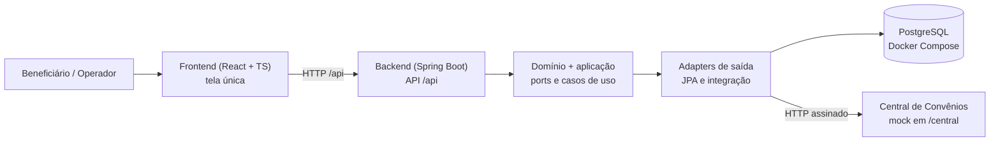
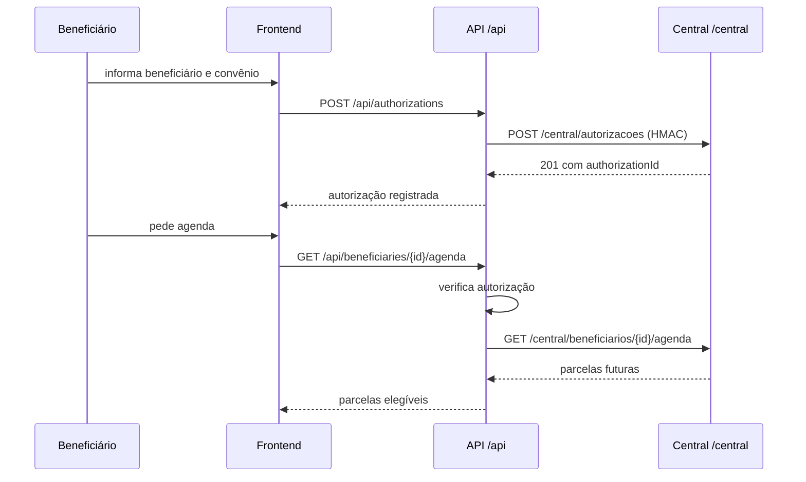
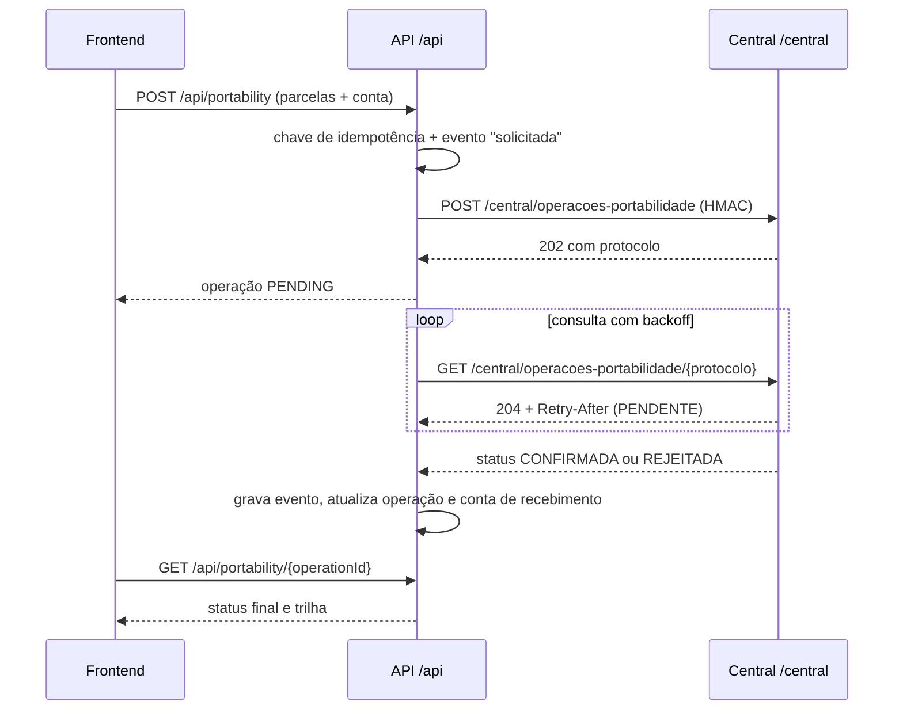

# HLD — High-level design

> **Dono:** visão geral do sistema, responsabilidades por camada e fluxos principais. Versões das
> tecnologias e contratos HTTP ficam no README, seções "Tecnologias" e "Documentação da API";
> detalhes de implementação em [`lld.md`](lld.md);
> convenções de código no [`../AGENTS.md`](../AGENTS.md); termos em [`../GLOSSARY.md`](../GLOSSARY.md).
> Quando uma tarefa alterar algo registrado aqui, carregue a skill `hld` (se disponível) em modo
> atualizar antes de editar este arquivo.

## Contexto do sistema

## Responsabilidades por camada

| Camada | Responsabilidade | Não faz |
| --- | --- | --- |
| Frontend (`frontend/`) | Apresentar os quatro painéis, coletar entradas, selecionar parcelas, exibir status/auditoria e erros | Regras de negócio, acesso direto a banco/API fora do `client.ts` |
| `adapters/in/web` | Receber HTTP, validar entrada e traduzir para casos de uso | Regras de domínio, acesso a repositórios |
| `application` | Orquestrar casos de uso usando ports | Conhecer HTTP, JPA ou a Central |
| `domain` | Modelo, invariantes e contratos (ports) | Depender de framework |
| `adapters/out/persistence` | Persistir em PostgreSQL via JPA e mapear para o domínio | Definir regras de negócio |
| `adapters/out/central` | Falhar com a Central, assinar/verificar e traduzir o contrato | Expor tipos da Central ao domínio |

A regra de dependência é sempre **para o domínio**. A Central simulada é um adapter interno, não um
terceiro projeto.

## Fluxo 1 — autorização e agenda

## Fluxo 2 — registro e confirmação assíncrona

## Documentos relacionados

- Versões das tecnologias: README, seção "Tecnologias".
- Contratos HTTP: README, seção "Documentação da API".
- Sequência detalhada, mapeamentos e estruturas internas: [`lld.md`](lld.md).
- Funcionalidades e status: [`roadmap.md`](roadmap.md).
